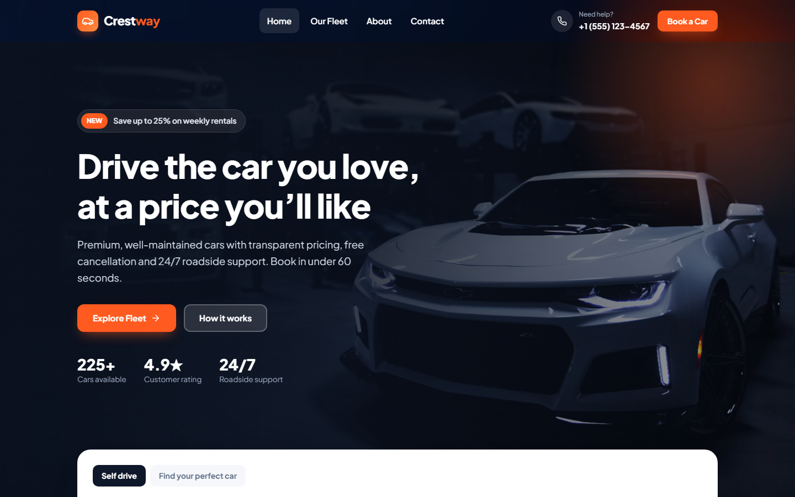
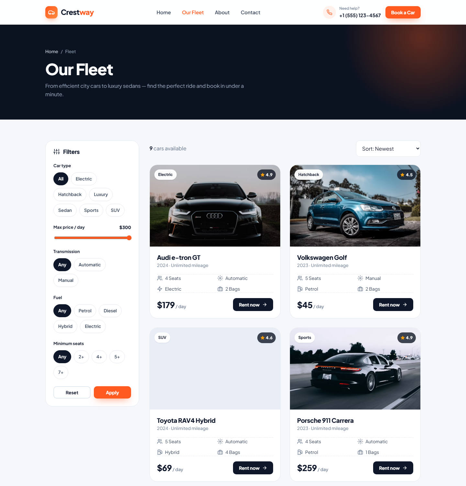
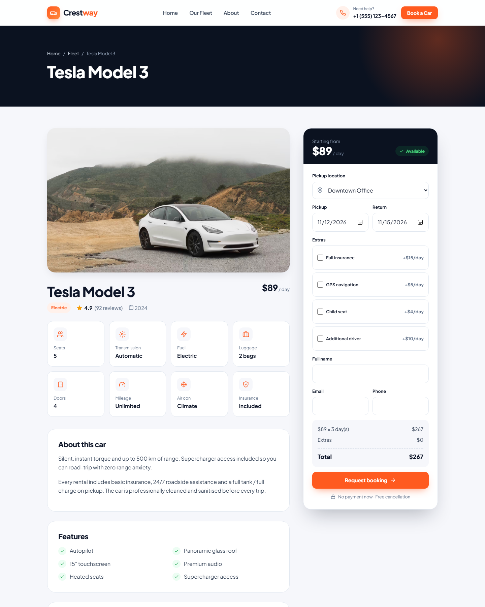
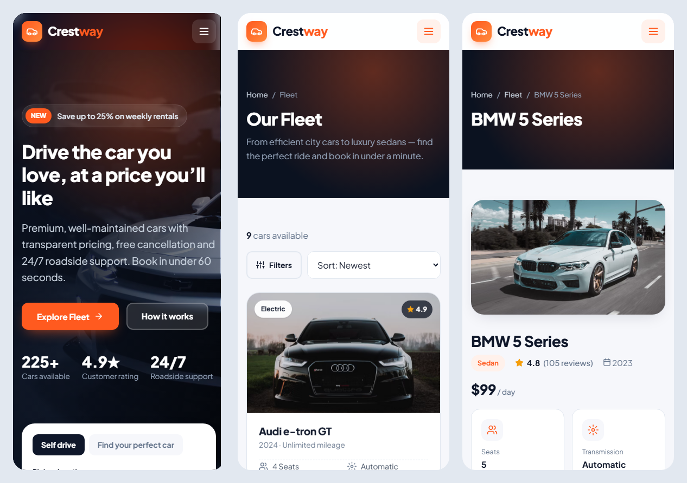

# Crestway Car Rental — WordPress Theme

A custom car rental WordPress theme built from scratch. It has no page builder and needs no plugins. Customers can browse the fleet, filter cars, see a live price and send a booking request. Staff manage cars and bookings from the WordPress admin.



## Features

| Area | What it does |
|---|---|
| **Fleet management** | `Car` post type: price/day, seats, doors, luggage, transmission, fuel, mileage, rating, features and a "featured" flag. Admin list shows a thumbnail, price and specs. |
| **Car types** | Taxonomy (SUV, Sedan, Luxury, Electric, Sports, Hatchback), each with its own archive page. |
| **Search & filters** | Homepage search (location, dates, type). The fleet page filters by type, max price, transmission, fuel and seats, and sorts by price or rating. |
| **Booking system** | Live price calculator (days × rate + extras). The price is recalculated on the server, then the booking is saved with a status (Pending / Confirmed / Completed / Cancelled) and emailed to the admin and the customer. |
| **Contact form** | Nonce and honeypot spam protection, sends to the admin email. |
| **Customizer** | Hero text and image, phone, email, address, hours, currency, pickup locations, footer credit. |
| **Demo importer** | Activating the theme creates 9 cars, the car types, Home / About / Contact pages and the menu. |
| **UI/UX** | Responsive (mobile-first), sticky header, scroll-reveal animations, animated counters, FAQ accordion, reduced-motion support, accessible labels and focus styles. |

## Screenshots

**Fleet with filters**


**Car details & booking**


**Mobile**


## Installation

1. Download this repository and zip the `crestway` folder (or download `crestway.zip` from Releases, if one is published).
2. In WordPress, go to **Appearance → Themes → Add New → Upload Theme**, upload the zip and click **Activate**.
3. Demo content, the menu and permalinks are set up automatically.

Settings are under **Appearance → Customize → Crestway Settings**. Bookings are under **Fleet → Bookings**.

## Tech

- WordPress (PHP 7.4+), custom post types, taxonomies, meta boxes, Customizer API, `admin-post` form handlers
- Vanilla JavaScript (no jQuery), CSS custom properties, CSS Grid/Flexbox
- Security: nonces, input sanitisation, output escaping, server-side price calculation

## Project structure

```
crestway/
├── style.css               # theme header + all styles (design tokens at top)
├── functions.php           # setup, assets, fleet filtering
├── inc/
│   ├── helpers.php         # icons, price/meta helpers, filters
│   ├── post-types.php      # car, car_type, bookings
│   ├── car-meta.php        # car details meta box + admin columns
│   ├── booking.php         # booking/contact handlers + bookings admin
│   ├── customizer.php      # theme settings
│   └── demo-content.php    # demo importer
├── front-page.php          # homepage
├── archive-car.php         # fleet + filters
├── single-car.php          # car detail + booking
├── page-contact.php        # contact page
├── template-parts/car-card.php
└── assets/js/main.js       # UI interactions + price calculator
```

---

Designed & developed by **Mesam Abbas**. Car photos are from [Unsplash](https://unsplash.com).
